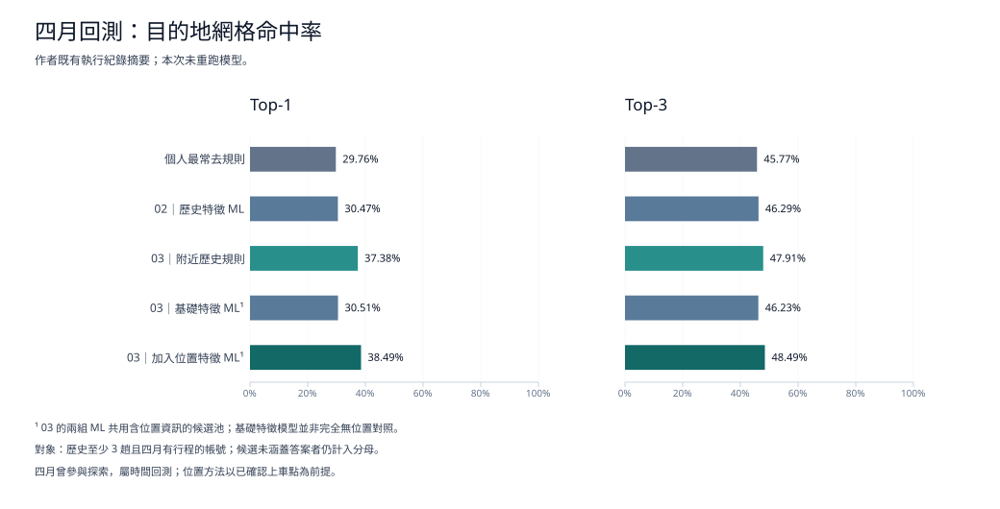

# yoxi：目的地捷徑與常用時段研究

探索歷史叫車行程如何支援目的地候選與常用時段提示，並以獨立手機介面示範確認起訖點的流程。這是概念研究，非 yoxi 官方服務。

公開版保留作者確認可公開的欄位名稱、研究方法、yoxi 名稱與彙總命中率。真實競賽資料、帳號明細、座標、逐筆預測、模型檔案及原始 Git 歷史均未提供。未新增 LICENSE。

## 檔案與方法

| Notebook | 用途 |
| --- | --- |
| `notebooks/yoxi_cleaning.ipynb` | 移除全空白及完全重複列，保留 POI 缺值與品質旗標；旗標不等於刪除。 |
| `notebooks/yoxi_analysis_01.ipynb` | 描述統計、近似 500 公尺網格、目的地規則、重疊行程敏感度分析與常用時段回測；不訓練 ML。 |
| `notebooks/yoxi_modeling_02.ipynb` | 個人 Top-10 與全體 Top-3 候選，以 HistGradientBoostingClassifier 二元評分後排序。 |
| `notebooks/yoxi_modeling_03.ipynb` | 加入已確認上車點附近 750 公尺的歷史，比較個人規則、位置規則及兩組 ML 特徵。 |

02／03 的兩個訓練快照起點為 2026-02-15、2026-03-01，驗證起點為 2026-03-16，四月回測為 2026-04-01 至 2026-05-01（不含）。每段評估歷史至少 3 趟且該段有下一趟的帳號，答案為該段第一趟目的地網格。完整切分、候選、特徵及原有參數保留於 notebook。

Top-1／Top-3 是目的地網格命中率，包含候選沒有答案的帳號；不是精確地址命中率、叫車機率或產品轉換率。模型分數未校準。四月曾參與前期探索，不是未接觸的最終測試集。

01 的 750 公尺容差比較候選下車代表點與實際下車點；03 則比較歷史上車點與本次已確認上車點。兩者用途不同，皆非網格邊界外擴。排程命中率的分母為預排的帳號／日期／兩小時時段。

## 已驗證成果的紀錄

以下為作者既有執行紀錄中的四月首趟回測結果；02 採修正個人規則口徑後的正式數字。本次整理僅核對紀錄文字，未讀取資料集或重新執行模型。

| 方法 | Top-1 網格命中率 | Top-3 網格命中率 |
| --- | ---: | ---: |
| 個人最常去規則（01／02／03 基準） | 29.76% | 45.77% |
| 歷史特徵 ML（02） | 30.47% | 46.29% |
| 上車附近歷史規則（03） | 37.38% | 47.91% |
| 基礎特徵 ML，共用位置候選池（03） | 30.51% | 46.23% |
| 加入位置特徵的 ML（03） | **38.49%** | **48.49%** |



加入位置特徵的 ML 相對個人規則，Top-1 約增加 **8.73 個百分點**、Top-3 約增加 **2.72 個百分點**；相對位置規則則約增加 **1.11、0.58 個百分點**。位置資訊提供主要的改善訊號，ML 的額外增益較小，兩者應分開解讀。

評估對象為三月底前至少 3 趟歷史、且四月有行程的帳號，每帳號只評第一趟；候選未涵蓋答案者仍計入分母。03 使用已確認的本次上車點，兩個 ML 共用含位置資訊的候選池。四月曾參與前期探索，不能稱為未接觸的最終測試，也不能將命中率視為線上轉換率。

三月驗證、01 的 750 公尺容差與排程結果，另列於各 notebook 文末。公開結果只保留上述評估摘要，不公開樣本明細或總帳號數。

## 本機環境

使用 Python 3，從此資料夾建立環境：

```sh
python -m venv .venv
```

Windows PowerShell 啟用方式：`.\.venv\Scripts\Activate.ps1`；macOS／Linux：`source .venv/bin/activate`。接著執行：

```sh
python -m pip install -r requirements.txt
python -m jupyterlab --notebook-dir=notebooks
```

依 cleaning → 01 → 02 → 03 閱讀，各 notebook 由上到下執行。02／03 獨立讀取同一清理檔，不依賴前一份 notebook 的記憶體狀態。

私人資料未提供，預設執行會因缺檔停止。只有在自行取得授權後，才建立根目錄 `data/`，放入 `data/raw.xlsx`；cleaning 產生 `data/yoxi_cleaned.csv`，01／02／03 使用該檔。Kernel 工作目錄須為 `notebooks/`；程式不搜尋磁碟、不使用環境變數回退路徑。所需欄位列於讀取 cell；Excel 時間欄位須可讀為 datetime，距離為公尺、時間為分鐘、時間戳為 UTC+8。

套件依實際 import 與 Excel／Notebook 執行需求列出，未鎖定尚未驗證的版本。本次未建立合成資料，也未執行清理、分析或模型訓練。

## 手機 demo

直接以瀏覽器開啟 `demo/index.html`。這是提供的 mobile demo ZIP 之整理副本，保留首頁、叫車、行程建議三個分頁、五位虛構乘客、目的地捷徑、起訖點修改、基本文字規則解析與簡報模式。

人物、地點、習慣、時間與天氣都是人工設定，不來自競賽資料。規則解析只支援簡單「從 A 到 B」等句型；捷徑順序也為人工設定。尚未串接 GenAI、真實 ML 推論、定位、地址解析、即時天氣、交通或叫車服務。外部 Google 地圖連結供自行查詢，頁內不會呼叫 API，也不儲存輸入內容。

若要啟用網頁展示，可於 GitHub **Settings → Pages → Deploy from a branch** 選擇發布分支及 **/(root)**。Demo 位址為 `https://<帳號>.github.io/yoxi-project/demo/`；不需建立後端或使用 Sites／ChatGPT 登入。

## 檢查範圍與限制

公開 notebook 已清空 code cell outputs、將 execution_count 設為 null，並移除附件、widget state、原始結果圖片與多餘 metadata；重寫原有長篇結論與對話文字，移除未授權的真實統計、資料筆數斷言及私人絕對路徑；經作者同意的命中率以 Markdown 摘要保留；比較圖只由這些彙總數字繪製，未讀取資料集。發布前若自行執行 notebook，仍須再次清除輸出並檢查內容；`.gitignore` 不能移除已追蹤檔案或 Git 歷史。

程式仍保留計算與顯示結果的操作。若在私人資料上重新執行並儲存，01 的熱區表可能包含網格及代表座標，其他 notebook 也會產生真實筆數、比例或績效。這些結果會存進已允許上傳的 `.ipynb`，不受資料檔的忽略規則保護。作者已同意公開本文及 notebook 文末列出的彙總命中率；其餘結果不因是彙總就自動公開。Notebook 的 code cell 輸出維持清空，避免夾帶明細。上傳範圍限於此 `yoxi_public` 資料夾，不包含原始專案或外層 `work/`。

本次僅做 Python／JavaScript 語法、Notebook 結構、靜態內容檢查與 demo 互動檢查。未重新驗證真實資料與模型結果，亦未驗證套件版本相容性或 GitHub Pages 線上部署。

保留的研究限制：01 早期的全期間重疊帳號排除僅能視為探索性敏感度分析，後段另有只用歷史的版本；03 的兩組 ML 共用含位置資訊的候選池，因此基礎特徵模型不是完全無位置對照。部分空子群比例可能除以零，原有方法尚未重跑驗證。快照依訂單建立時間切分，未另驗證跨 cutoff 行程的下車資訊是否已可取得，這項資料可用性風險未改寫。

本專案曾使用 AI 協助程式與文字整理，研究方法及結果仍需作者核對。
